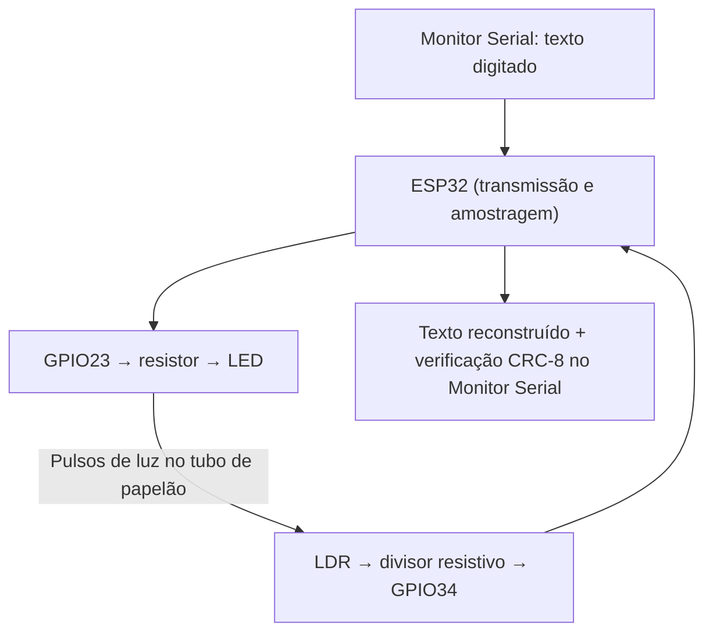

# Comunicador Óptico de Dados — Li-Fi de Baixo Custo

> Protótipo educacional que transmite mensagens por pulsos luminosos entre um LED e um fotorresistor (LDR), usando **um ESP32**.

**Situação (11/11/2026): protótipo funcional em bancada, com recepção de texto e detecção de erros por CRC-8 demonstradas.**  
**Apresentação prevista:** 18/11/2026.

## Demonstração

O usuário digita uma mensagem no Monitor Serial do Arduino IDE. O ESP32 converte cada byte em bits, aciona o LED (1 = aceso; 0 = apagado), mede a luminosidade pelo LDR e reconstrói o texto. Depois transmite mais um byte de **CRC-8** pelo mesmo canal luminoso para verificar a integridade dos dados recebidos.

**Limite da arquitetura:** esta montagem é um **loopback óptico sincronizado**. O mesmo ESP32 controla a saída luminosa e os instantes de leitura do LDR, e conhece previamente o tamanho da mensagem. Não é uma rede Li-Fi padronizada e não é um enlace assíncrono entre dois equipamentos independentes. O texto recebido, entretanto, é reconstruído a partir da **leitura real da luz**, não copiado da mensagem original.

## Montagem

- ESP32 DevKit, LED de alto brilho de 5 mm, LDR, 2 protoboards, fios e tubo de papelão.
- LED: **GPIO23 → resistor limitador (220–330 Ω) → ânodo do LED; cátodo → GND**.
- LDR: **3V3 → LDR → nó de medição GPIO34 → resistor de 10 kΩ → GND**.
- Mapeamento de furos das duas protoboards: [hardware/mapeamento-atual.md](hardware/mapeamento-atual.md), caso tenha aplicado a atualização anterior.
- Confira os valores reais dos resistores antes de energizar. **Nunca conecte 5 V diretamente ao GPIO34**.
- Use papelão ou revestimento **não condutor** para bloquear luz lateral. Papel-alumínio encostou nos terminais numa tentativa anterior e causou leituras anormais; após removê-lo, o circuito voltou a funcionar.

## Executar a versão com CRC-8

1. Instale o Arduino IDE e o pacote `esp32 by Espressif Systems`.
2. Conecte o ESP32 por USB; selecione **ESP32 Dev Module** e a porta correta.
3. Abra [firmware/05_comunicador_crc8/05_comunicador_crc8.ino](firmware/05_comunicador_crc8/05_comunicador_crc8.ino).
4. Envie o programa e abra o **Monitor Serial a 115200 baud** com final de linha **Nova linha**.
5. Digite `ola mundo` (sem acentos) e pressione Enter.
6. Observe o texto reconstruído, o CRC transmitido, o CRC recebido e o CRC recalculado.

O código usa **300 ms por bit** (~3,33 bit/s brutos) e limiar ADC **1500**, valores observados como funcionais nesta montagem com tubo. Recalibre o limiar se a iluminação ou o alinhamento mudarem.

## Resultados registrados

| Experimento | Resultado observado |
|---|---|
| LED/LDR sem tubo | ~3270 aceso; ~1900 apagado |
| LED/LDR com tubo | ~2850–2915 aceso; 0 apagado, em medições típicas |
| Sequência `10110` | Bits recuperados corretamente |
| Mensagens personalizadas | Texto reconstruído corretamente em ensaios mostrados |
| Intervalos de 700, 500 e 300 ms/bit | Sucesso relatado com `ola mundo` em cada intervalo |
| Texto `ola mundo`, CRC-8, sem obstáculo | Original, recebido e recalculado: **0xBE** |
| Mesmo texto, obstáculo no feixe | CRC recebido **0xBE**, recalculado **0x84**; erro sinalizado |

Detalhes e ressalvas em [testes/registro-de-testes.md](testes/registro-de-testes.md).

## Limitações e próximos passos

- A taxa de 300 ms/bit foi validada nos testes relatados, **não** é uma velocidade máxima comprovada.
- CRC-8 detecta diversos erros acidentais, mas não todos; **não corrige** os dados.
- O programa também compara texto enviado/recebido **somente como diagnóstico local**, aproveitando o loopback.
- O quadro é educativo, de baixa taxa de bits, não um sistema Li-Fi de rede.
- A adição de buzzer passivo foi **adiada** porque faltam especificações elétricas e circuito de acionamento validado.
- Futuras melhorias: sincronismo independente, mais testes quantitativos, documentação fotográfica e aprimoramento do protocolo.

## Estrutura principal

- `firmware/01_teste_led/`: verificação inicial do LED
- `firmware/02_teste_ldr/`: verificação inicial do LDR
- `firmware/03_comunicador_optico/`: protótipo anterior, experimental
- `firmware/04_teste_bits_tubo/`: teste binário, se incluído na atualização anterior
- `firmware/05_comunicador_crc8/`: **versão atual recomendada**
- `hardware/`: componentes, ligações e mapa das protoboards
- `testes/`: registros experimentais
- `docs/`: explicações e evolução
- `imagens/` e `apresentacao/`: materiais a completar

## Créditos

Projeto desenvolvido para apresentação escolar em 18/11/2026. Preencha autores, turma, instituição e orientador. Licença ainda não definida.
