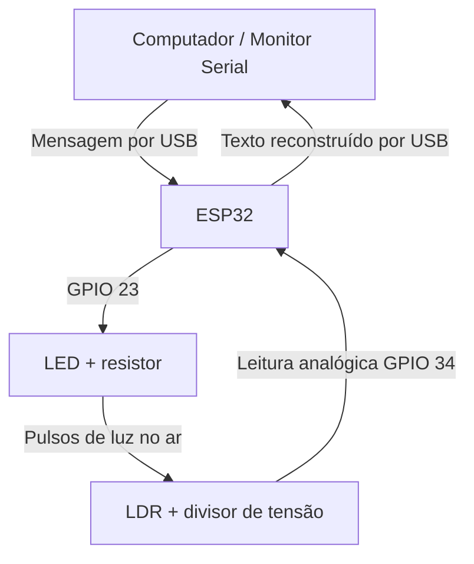

# Comunicador Óptico de Dados — Li-Fi de Baixo Custo

> Projeto didático em desenvolvimento: transmissão de texto por luz visível com **um ESP32, um LED e um fotorresistor (LDR)**.

**Estado:** 🧪 protótipo ainda não validado em bancada.  
**Apresentação prevista:** 18/11/2026.

## Objetivo

Enviar uma mensagem de texto por pulsos luminosos: o ESP32 transforma cada byte em bits, controla um LED, mede a luz recebida pelo LDR e reconstrói os bytes a partir das leituras do sensor. É uma demonstração educacional de comunicação óptica de baixa velocidade, inspirada no conceito de Li-Fi; **não é uma implementação de rede Li-Fi padronizada**.

## Arquitetura atual: um ESP32



**Importante:** transmissor e receptor compartilham o mesmo ESP32, que conhece os instantes de envio. É um **laço óptico local (loopback)**, não uma comunicação entre dois dispositivos independentes. O programa **não copia** a mensagem original para a saída recebida: ele reconstrói o texto a partir das medições no LDR. Uma versão futura pode usar dois microcontroladores para transmitir sem sincronização interna.

## Componentes

- 1 ESP32 DevKit de 38 pinos (placa preta fotografada; conferir pinagem na própria placa)
- 1 LED visível, preferencialmente de alto brilho
- 1 LDR (fotorresistor)
- 1 resistor de **220 Ω ou 330 Ω** para o LED
- 1 resistor de **10 kΩ** para o divisor do LDR
- 1 ou 2 protoboards, fios jumper, cabo USB de **dados** e notebook
- Opcional: tubo de papelão para bloquear a luz ambiente

**Atenção:** os valores dos resistores fotografados ainda precisam ser confirmados pelas faixas/multímetro. Um módulo conversor USB-serial vermelho que aparece nas fotos **não é outro ESP32** e não é necessário nesta montagem.

## Como começar

1. Instale [Arduino IDE](https://www.arduino.cc/en/software) e adicione o pacote **esp32 by Espressif Systems**.
2. Escolha a placa **ESP32 Dev Module** (ponto de partida) e a porta correspondente ao ESP32.
3. Veja [hardware/ligacoes.md](hardware/ligacoes.md) antes de energizar o circuito.
4. Teste `firmware/01_teste_led/01_teste_led.ino`.
5. Teste `firmware/02_teste_ldr/02_teste_ldr.ino`.
6. Execute `firmware/03_comunicador_optico/03_comunicador_optico.ino` e envie uma frase pelo Monitor Serial.
7. Anote resultados e ajustes em [testes/registro-de-testes.md](testes/registro-de-testes.md).

> Os programas são **códigos iniciais para teste**, ainda não executados no hardware real. O experimento final depende da posição do LED, da iluminação ambiente, do valor do resistor e da calibração.

## Organização dos arquivos

```text
comunicador-optico-li-fi-esp32/
├── README.md
├── .gitignore
├── firmware/
│   ├── 01_teste_led/
│   ├── 02_teste_ldr/
│   └── 03_comunicador_optico/
├── hardware/
│   ├── componentes.md
│   └── ligacoes.md
├── docs/
│   ├── fundamentos.md
│   ├── instalacao-arduino-ide.md
│   └── roteiro-apresentacao.md
├── testes/
│   └── registro-de-testes.md
├── imagens/
│   └── README.md
└── apresentacao/
    └── README.md
```

## Como funciona a codificação

Cada caractere é transmitido como oito bits. Por exemplo, `A` em ASCII equivale a `01000001`. LED aceso representa 1; LED apagado, 0. O código integrado faz uma calibração e lê o LDR durante cada intervalo de bit. Começamos com intervalos longos porque o LDR é lento em comparação com sensores ópticos próprios para dados.

## Resultados

**Ainda não coletados.** Quando a montagem funcionar, adicionar fotos, exemplos de mensagens, taxas de acerto e limitações. Nunca substituir resultados medidos por resultados imaginados.

## Próximas melhorias

- Reforçar o isolamento da luz ambiente com tubo de papelão.
- Medir a taxa de erros e ajustar duração dos bits.
- Implementar sincronização independente e um segundo microcontrolador (opcional).

## Autoria e licença

Preencher nome(s), escola/curso e orientador antes de publicar. **Nenhuma licença foi escolhida neste pacote**; consulte `docs/licenca-e-creditos.md`.
